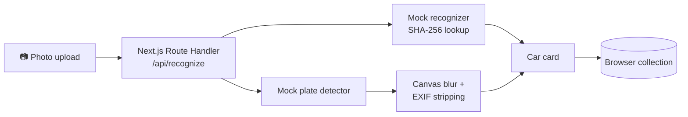
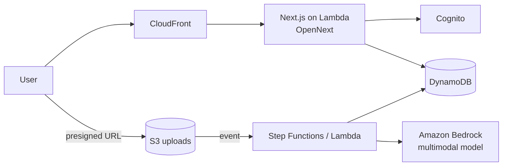

<div align="center">

# 📸 carspotr

**Snap a car. Let AI name it. Build your collection.**

A car spotting app that identifies **make, model and generation** from a single photo,
built with **Next.js 16** on a **serverless AWS** stack and **Amazon Bedrock** multimodal AI —
with **privacy by design** from day one.


[Features](#-features) · [How it works](#-how-it-works) · [Privacy by design](#-privacy-by-design) · [Getting started](#-getting-started) · [Roadmap](#-roadmap)

</div>

---

## ✨ Features

- 🚗 **Car recognition from a photo**: make, model, generation, production years and a confidence score.
- 🏆 **Rarity tiers**: every spot is ranked *Common*, *Uncommon*, *Rare* or *Legendary*.
- 🗂️ **Personal collection** of everything you have spotted.
- 🔒 **Licence plate blurring** before a photo is ever stored.
- 🧹 **EXIF and GPS stripping**: no hidden location data leaves your device.
- 🧩 **Swappable AI engine**: a single `CarRecognizer` interface, so the mock and Amazon Bedrock are interchangeable.

## 🧠 How it works

**Today (phase 1, fully local)**



**Target architecture (AWS serverless)**



The recognizer is deterministic in phase 1: the same photo always returns the same car, so the whole app can be
built and tested before the real model is plugged in.

## 🔒 Privacy by design

Licence plates and faces are personal data under the **GDPR**. carspotr treats them that way:

| Risk | Mitigation |
| --- | --- |
| Licence plates identify the owner | Plates are blurred before storage |
| Faces of drivers and passers-by | Faces are blurred too (detector ready, phase 2) |
| Photos carry GPS coordinates | The image is re-encoded, removing all EXIF metadata |
| Tracking a single car over time | Rarity is computed per model, never per plate; plates are never stored as text |
| Unwanted exposure | Collections are private by default |

## 🚀 Getting started

**Prerequisites:** Node.js 20.9 or later.

```bash
git clone https://github.com/berserker95/carspotr.git
cd carspotr
npm install
npm run dev
```

Open [http://localhost:3000](http://localhost:3000) and upload a photo of a car (JPEG, PNG or WebP, up to 8 MB).

| Script | What it does |
| --- | --- |
| `npm run dev` | Starts the dev server with Turbopack |
| `npm run build` | Production build |
| `npm run lint` | Runs ESLint |

## 🗂️ Project structure

```text
src/
├── app/
│   ├── api/recognize/route.ts   # upload validation + recognition endpoint
│   └── page.tsx                 # home page
├── components/
│   └── spot-uploader.tsx        # upload, car card and collection UI
└── lib/
    ├── recognizer.ts            # CarRecognizer / PrivacyDetector contracts + mocks
    ├── redact.ts                # canvas blurring and EXIF stripping
    ├── collection.ts            # local collection storage
    └── types.ts                 # shared types
```

## 🛣️ Roadmap

- [x] **Phase 1** · Local MVP: upload, mock recognition, simulated plate blurring, EXIF stripping
- [ ] **Phase 2** · AWS free plan account, 1 USD budget alarm, least-privilege IAM
- [ ] **Phase 3** · Real recognition with Amazon Bedrock, real plate and face detection
- [ ] **Phase 4** · Infrastructure as code with AWS CDK: S3 presigned uploads, Lambda, DynamoDB
- [ ] **Phase 5** · Next.js on AWS (OpenNext + CloudFront), Cognito auth, GitHub Actions with OIDC
- [ ] **Phase 6** · Cost dashboard, daily recognition cap, ADRs and real numbers in this README

## 🧰 Tech stack

- **Frontend:** Next.js 16 (App Router, Turbopack) · React 19 · TypeScript · Tailwind CSS 4
- **Cloud (planned):** AWS Lambda · Amazon S3 · Amazon CloudFront · Amazon DynamoDB · AWS Step Functions · Amazon Cognito · AWS CDK
- **AI (planned):** Amazon Bedrock multimodal foundation models
- **Delivery (planned):** GitHub Actions with OIDC, AWS Budgets

---

<div align="center">

Built for the love of cars and clean cloud architecture. 🏁

</div>
